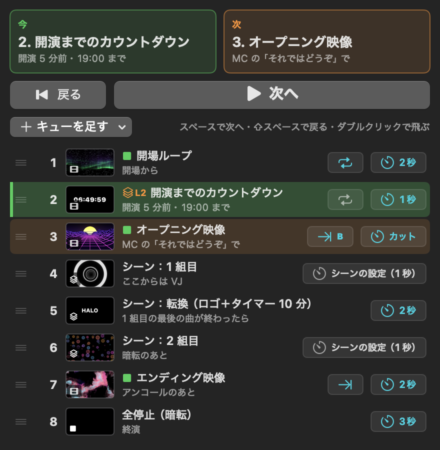
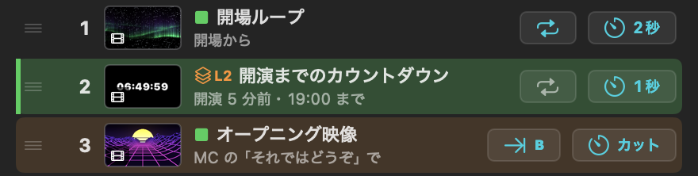
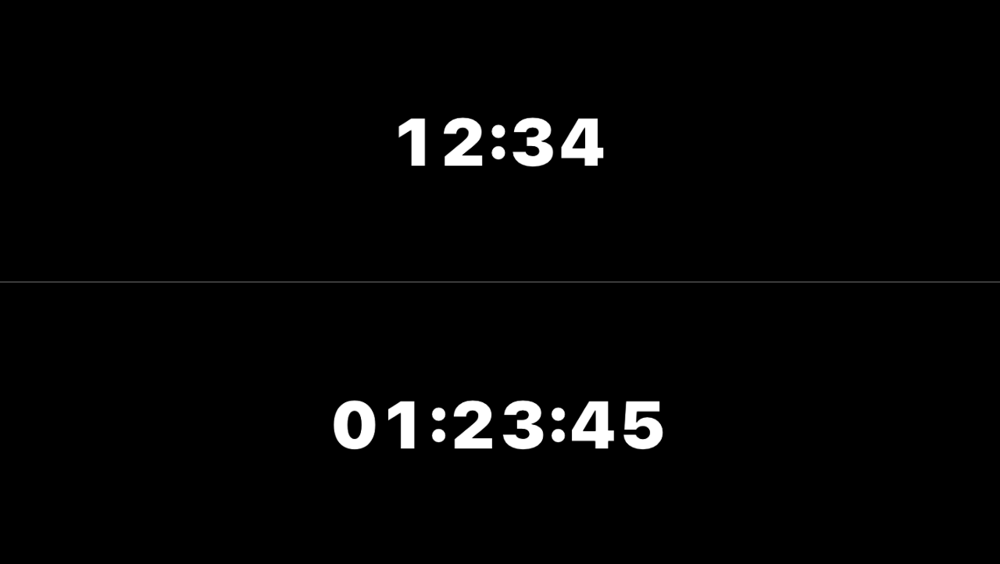
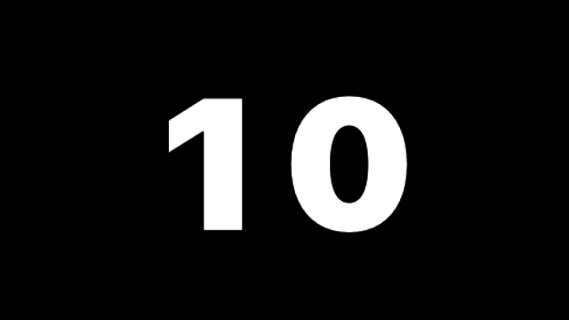
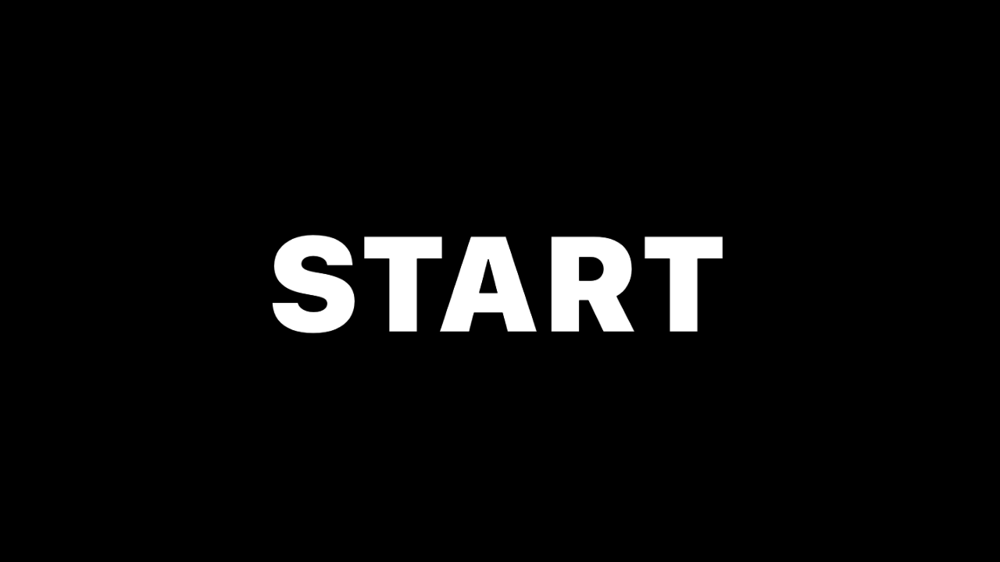
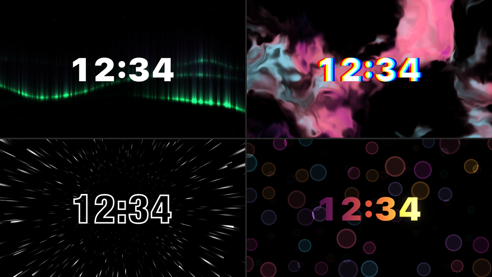
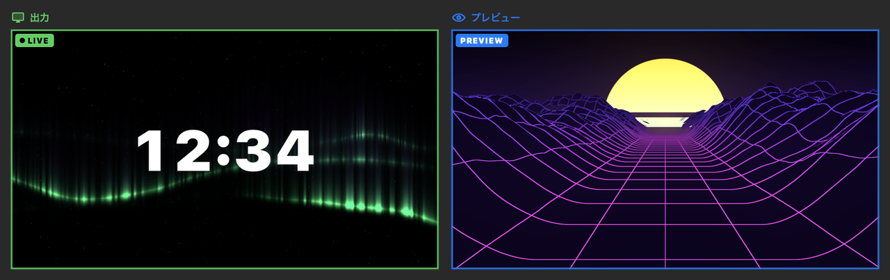
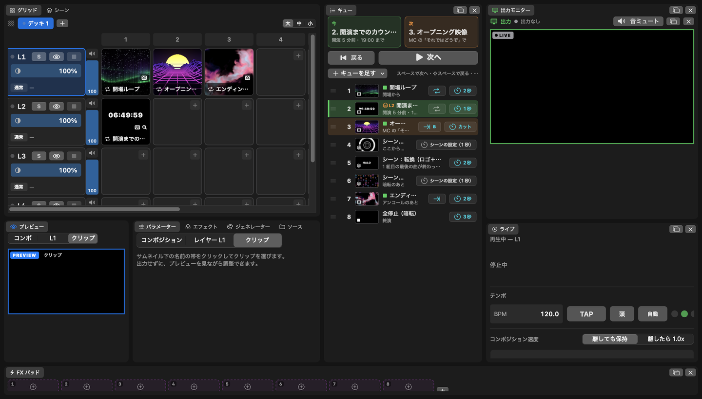

<!-- 見出し画像：img/01-header.png -->

# VJ ソフトで「ポン出し」もやる：キューリストとカウントダウンでイベントを進行する

自作の macOS 用 VJ ソフト「Halo VJ」に、ポン出し用の機能がそろってきたので紹介します。

VJ ソフトというと、曲に合わせて映像を混ぜるものを思い浮かべると思います。でも実際の現場では、「オープニング映像を頭から出す」「転換中にロゴを出しておく」「開演までのカウントダウンを出す」といった、進行どおりに決まった映像を出す仕事もかなりあります。Halo VJ は、この両方を 1 つのソフトでできるようにしています。

（先にお断り：Halo VJ は AI と対話しながら作っている開発中のソフトです。動作の検証は十分ではないので、大事な本番でいきなり使うのは控えて、まずはリハーサルや小さな現場で試してください。）

## ポン出しとは

決まった映像や音を、きっかけに合わせて「ポン」と出すことです。大事なのは 3 つです。

- 押した瞬間に、頭から出る
- 次に何が出るかが、ひと目で分かる
- 押し間違えても事故にならない

Halo VJ では、この 3 つを「キュー」パネルにまとめています。

## キューリスト：スペースキーで次へ

出すものを上から順に並べておき、スペースキーを押すたびに次へ進みます。

- 「今」と「次」が大きく出るので、暗い現場でも迷いません
- ⇧スペースで 1 つ前に戻れます
- ダブルクリックで、好きなキューへ飛べます
- 連打は 0.5 秒間受け付けないので、二度押しで 1 つ飛ばす事故を防げます

キューにできるのは 3 種類です。

- **クリップ**：その映像だけを出します。ほかのレイヤーはフェードして止まります（「ほかのレイヤーはそのまま」にもできます）
- **シーン**：複数のレイヤーとエフェクトの状態を、丸ごと呼び出します
- **全停止**：すべて止めます

追加は、グリッドのクリップやシーンをキューの一覧へドラッグするだけです。

## キューごとに決められること

- **フェード時間**：カットから 8 秒まで
- **終わったら**：ループ・往復・最後のコマで停止・ブラックアウト
- **メモ**：「MC の『それではどうぞ』で」のような、きっかけを書いておけます

たとえばオープニング映像は「カットで出して、終わったらブラックアウト」、転換中のロゴは「2 秒フェードでループ」、という決め方ができます。

## カウントダウンを出す

Halo VJ には、時計・カウントダウンのジェネレーターが入っています。動画の素材を用意しなくても、その場で作れます。

モードは 4 つです。

- **カウントダウン**：「19:00 まで」のように、目標の時刻までを数えます。開演や年越しに向いています
- **タイマー**：クリップを出した時点から、決めた長さを数えます。「転換 10 分」「休憩 15 分」に向いています
- **今の時刻**：時計です
- **ストップウォッチ**

見せ方も、イベント向けに作ってあります。

- 最後の 10 秒は、数字だけの大きな表示になります

- 0 になったら出す文字を決められます（「START」「HAPPY NEW YEAR」など）

- 数字は幅をそろえて描くので、横にぶれません
- フォント・色・縁取り・グリッチなどは、文字のジェネレーターと同じように変えられます

ジェネレーターも普通のクリップと同じなので、キューに並べられます。下のレイヤーにループ映像を流し、上のレイヤーにカウントダウンを重ねる、という使い方もできます。エフェクトもそのままかかります。

## ライブイベントの組み方の例

ある日のライブなら、キューはこう並びます。

1. 開場中のループ映像（2 秒フェード・ループ）
2. 開演までのカウントダウン（目標 19:00・「ほかのレイヤーはそのまま」で上に重ねる）
3. オープニング映像（カット・終わったらブラックアウト）
4. 1 組目のシーン（ここからは VJ として映像を混ぜる）
5. 転換：ロゴ＋タイマー 10 分
6. 2 組目のシーン
7. エンディング映像（終わったら最後のコマで停止）
8. 全停止

進行はスペースキーで送り、バンドの演奏中はグリッドと FX パッドで自由に VJ をする。1 つのソフトの中で、この 2 つを行き来できます。

## 事故を防ぐための作り

- **Esc でブラックアウト**：映像と音をフェードで消します。クリップは裏で再生を続けるので、もう一度押せば元に戻ります
- **出さずに確かめる**：クリップの名前の帯をクリックすると、出力には出さずにプレビューで中身を見られます
- **出力とプレビューを色で見分ける**：出力モニターは緑の枠と「● LIVE」、プレビューは青の枠と「PREVIEW」。グリッドの「出力中」（緑）・選択（青）と同じ色です（v0.6.3 から）
- **ポン出し向けの画面**：ワークスペース「Show」に切り替えると、キューを中心にした並びになります

## 入手

- 紹介ページ：https://yama203.github.io/halo-vj/
- 説明書（キュー）：https://yama203.github.io/halo-vj/docs/
- ダウンロード：https://github.com/yama203/halo-vj/releases

Apple シリコンの Mac、macOS 14 以上で動きます。無料です。

使ってみて気づいたことがあれば、ぜひ教えてください。
